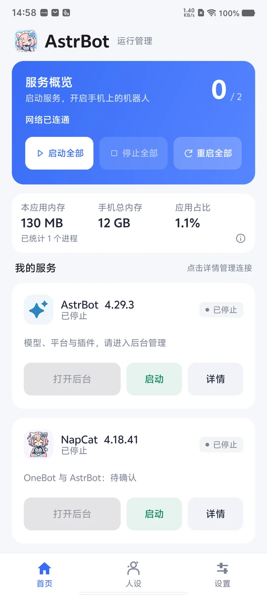
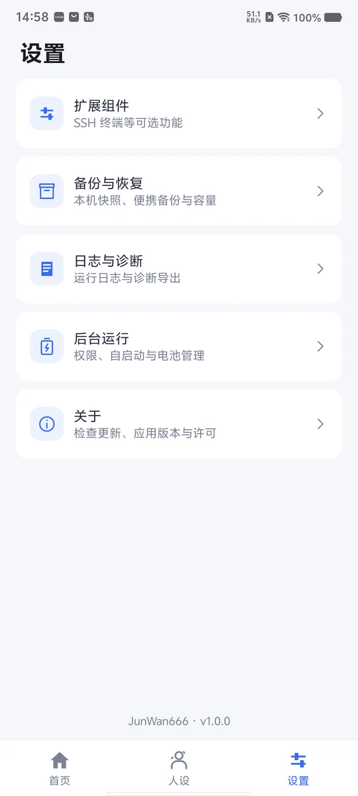
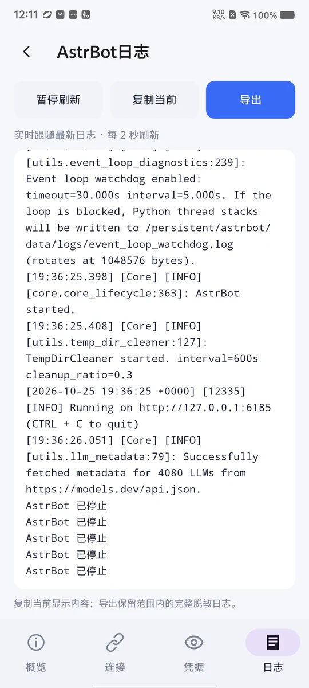
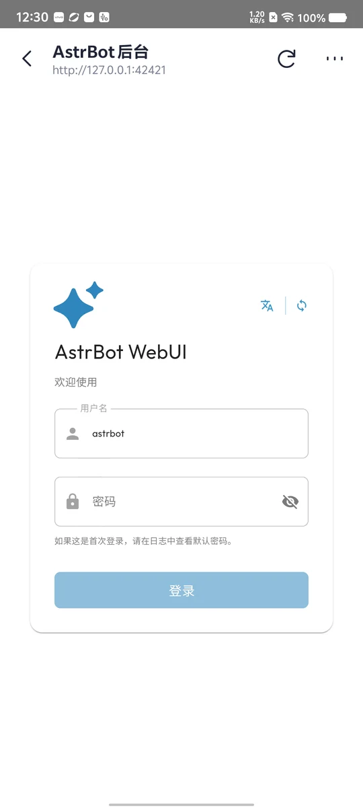
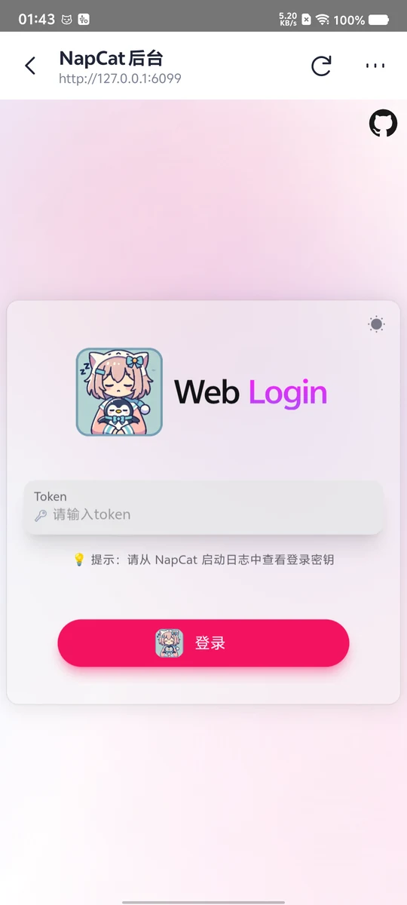

<div align="center">
  
  <h1>AstrBot for Android</h1>
  <p><strong>简体中文</strong> | <a href="./docs/README.en.md">English</a></p>
  <p><strong>把 AstrBot 和 NapCat，装进你的 Android 手机。</strong></p>
  <p>一个 APK · 本地运行 · 原生管理 · 内置 WebUI</p>
  <p>
    
    
    
  </p>
  <p>
    <a href="https://github.com/JunWan666/astrbot-for-android/releases/latest"></a>
    
    
    <a href="./LICENSE"></a>
    <a href="https://github.com/JunWan666"></a>
  </p>
  <p>
    <a href="https://github.com/JunWan666/astrbot-for-android/releases/latest">下载 APK</a> ·
    <a href="#界面预览">界面预览</a> ·
    <a href="#开始使用">开始使用</a> ·
    <a href="./docs/使用指南.md">使用指南</a> ·
    <a href="./docs/构建指南.md">源码构建</a> ·
    <a href="./docs/CHANGELOG.md">更新记录</a>
  </p>
</div>

## 项目简介

**AstrBot for Android（AstrBot 运行管理器）** 是面向 Android 设备的 AstrBot 与 NapCat 本地部署及运行管理应用。通过单个 APK 集成 PRoot Ubuntu 运行环境与服务组件，提供环境初始化、服务启停、状态监控、日志查看、备份恢复及独立在线更新等功能，无需 Root。

应用采用 Kotlin 与 Jetpack Compose 构建原生管理界面，支持简体中文与英文，通过内置 WebView 访问 AstrBot 和 NapCat 的 WebUI，在手机端完成 QQ 登录、模型接入与插件配置，并提供人设管理、局域网访问、SSH 终端与 cpolar 内网穿透扩展。

## 界面预览

当前正式版本为 **v1.0.0**。主分支和下方截图包含开发中的中英文界面、cpolar 扩展与存储提醒调整，相关功能将在后续版本发布。

<table width="100%" align="center">
  <tr>
    <td align="center" width="33%">
      
      <p align="center"><strong>首页 · 服务与资源</strong></p>
    </td>
    <td align="center" width="33%">
      
      <p align="center"><strong>人设 · 搜索与切换</strong></p>
    </td>
    <td align="center" width="33%">
      
      <p align="center"><strong>设置 · 运行与维护</strong></p>
    </td>
  </tr>
  <tr>
    <td align="center" width="300">
      
      <p align="center"><strong>服务日志 · 实时跟随</strong></p>
    </td>
    <td align="center" width="300">
      
      <p align="center"><strong>AstrBot · 内置后台</strong></p>
    </td>
    <td align="center" width="300">
      
      <p align="center"><strong>NapCat · 内置后台</strong></p>
    </td>
  </tr>
</table>

## 功能特性

| 功能 | 说明 |
| --- | --- |
| 双服务管理 | AstrBot / NapCat 独立或一键启停，查看运行、连接和异常状态 |
| 内置后台 | 直接打开原 WebUI，预填有效的初始凭据，也可使用外部浏览器 |
| 固定缩放 | 默认 75%，支持 100% / 75% / 50% / 25%，关闭双指缩放 |
| 本机互联 | 新装准备 `ws://localhost:6199/ws`、空 token 的 OneBot 配对，已有配置保留 |
| 局域网访问 | 两套 WebUI 可分别开放局域网访问，显示可复制地址，保留后台鉴权 |
| 人设库 | 内置 12 款原创预设，支持自行新增、删除（含内置预设）、搜索、分类和默认切换，提供外部人设市场入口 |
| 实时日志 | 在服务详情中查看，自动跟随最新输出，可暂停、复制和脱敏导出 |
| 资源概览 | 显示应用及托管进程内存、手机总内存和占比，单独查看存储使用情况 |
| 备份与恢复 | 支持本机快照、便携备份和更新回退，自动清理未受保护的旧自动快照 |
| SSH 扩展 | 默认安装、按需启动，支持修改密码、端口和局域网访问设置 |
| cpolar 扩展 | 按需安装，内嵌官方 WebUI 登录与隧道管理，默认提供 SSH、AstrBot、NapCat 三个隧道 |
| 中英文界面 | 支持跟随系统、简体中文与 English，覆盖管理界面、通知与操作提示 |
| 后台引导 | 提供通知、电池优化、后台无限制、自启动权限及任务锁定入口 |
| 更新管理 | App、AstrBot、NapCat 分别检查和更新，下载校验后确认安装 |

首页和设置采用固定布局，小窗口分页；人设与日志区域支持滚动。进入服务详情后，底部导航切换为该服务的概览、连接、凭据和日志。

## 开始使用

1. 从 [Releases](https://github.com/JunWan666/astrbot-for-android/releases/latest) 下载完整 APK，在 ARM64 Android 手机上安装，打开 App 完成环境初始化。
2. 点击“启动全部”，等待 AstrBot 和 NapCat 就绪。
3. 打开 NapCat 后台登录 QQ，在 AstrBot 后台配置模型、平台和插件。
4. 按“设置 → 后台运行”的引导调整手机权限，再按需使用人设、备份、SSH 和 cpolar。

完整包内置运行环境，初始化无需另外下载 Ubuntu 或安装项目依赖。QQ 登录、模型调用和在线更新需要网络，账号与 API Key 直接在对应 WebUI 中配置。更多操作见[使用指南](docs/使用指南.md)。

### 设备与空间

- Android 8.0 / API 26 及以上，ARM64 架构，无需手机 Root。
- 完整 APK 约 **720 MiB**，安装后还需为运行环境、QQ 数据和备份预留空间。
- 环境准备空间不足时显示预估提醒，可选择“仍然继续”；实际可写空间耗尽仍会导致操作失败。
- 运行占用随插件、模型调用及 QQ 状态变化；首页显示实际应用内存，不预分配虚拟机内存。
- 持续运行需要按手机系统设置后台权限，应用目前不提供开机自动启动。

cpolar 在“设置 → 扩展组件”中单独下载安装，客户端不打入 APK。登录官方 WebUI 后自动保存令牌，可管理三个默认隧道；隧道目标服务需在 App 中启动，服务能力以 cpolar 账号套餐为准。

## 源码构建

使用 JDK 17、Android SDK 35、NDK 和 Python 3.11+。编译应用源码：

```powershell
./gradlew.bat :core:compileKotlin :app:compileBootstrapReleaseKotlin
```

完整 APK 需要另外准备运行镜像、原生资源和许可输入，大型资源与本机配置不进入 Git。准备好输入和长期签名后，Windows 双击根目录 `build.bat`，其他系统执行 `python3 -B tools/build_release.py`，即可完成正式构建、签名和校验。默认输出到 `dist/`，具体步骤见[构建指南](docs/构建指南.md)。

长期密钥及密码位于 Git 已忽略的 `.local/signing/`，后续版本持续复用；首次创建与备份方法见[一键构建正式包](docs/构建指南.md#一键构建正式包)。

## 更新

“设置 → 关于 → 检查更新”管理 App 安装包，AstrBot 与 NapCat 各有独立的程序更新入口。兼容的组件新版无需重新安装 App。更新支持签名校验、断点续传、安装前快照和失败回退，下载完成后由用户确认安装。

默认接入本项目的 GitHub 签名更新通道：**Releases 存放安装包和 AstrBot 程序包，`updates` 分支托管签名目录，NapCat 直接下载上游官方 Shell 包**。只有 QQ、Python 或底层依赖变化时，才需要匹配的运行环境升级。配置方式见[更新与分发](docs/更新与分发.md)。

## 交流与反馈

<p align="center">
  <a href="https://qm.qq.com/q/fS2CdoBQB2"></a>
</p>

欢迎加入 QQ 交流群，交流 App 使用、AstrBot / NapCat 配置、人设分享和功能建议。也可以通过 [GitHub Issues](https://github.com/JunWan666/astrbot-for-android/issues) 反馈问题，便于跟进和检索。

## 文档

- [使用指南](docs/使用指南.md)：后台配置、人设、语言、SSH、cpolar、资源和备份。
- [构建指南](docs/构建指南.md)：开发环境、运行资源和 APK 构建。
- [更新与分发](docs/更新与分发.md)：应用签名、更新通道和 GitHub 发布。
- [发行材料](docs/发行材料.md)：第三方许可、依赖清单和源码伴随包。
- [更新记录](docs/CHANGELOG.md) · [参与开发](.github/CONTRIBUTING.md) · [提交规则](.github/GIT_COMMIT_RULES.md)。

## 开源协议与致谢

本项目原创代码采用 [MIT License](LICENSE)，**Copyright © 2026 [JunWan666](https://github.com/JunWan666)**。使用或分发时请保留版权声明和许可文本。

感谢 [AstrBot](https://github.com/AstrBotDevs/AstrBot)、[NapCatQQ](https://github.com/NapNeko/NapCatQQ)、[PRoot](https://github.com/proot-me/proot)、Ubuntu、Termux 及相关开源项目。第三方组件遵循各自的许可与分发条款，详见 [NOTICE](docs/legal/NOTICE) 和 [第三方声明](docs/legal/THIRD_PARTY_NOTICES.md)。

## Star History

<div align="center">
  <a href="https://www.star-history.com/?repos=JunWan666%2Fastrbot-for-android&amp;type=date&amp;legend=top-left">
    <picture>
      <source media="(prefers-color-scheme: dark)" srcset="https://api.star-history.com/chart?repos=JunWan666/astrbot-for-android&amp;type=date&amp;theme=dark&amp;legend=top-left" />
      <source media="(prefers-color-scheme: light)" srcset="https://api.star-history.com/chart?repos=JunWan666/astrbot-for-android&amp;type=date&amp;legend=top-left" />
      
    </picture>
  </a>
</div>
