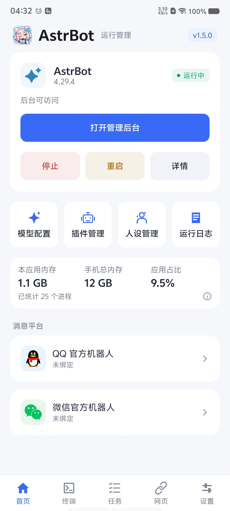
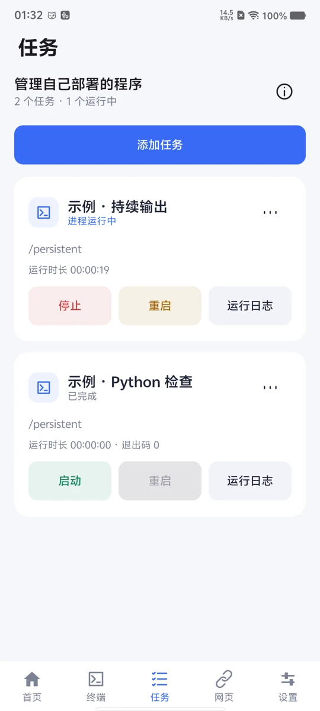
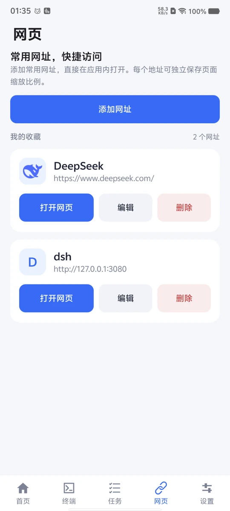
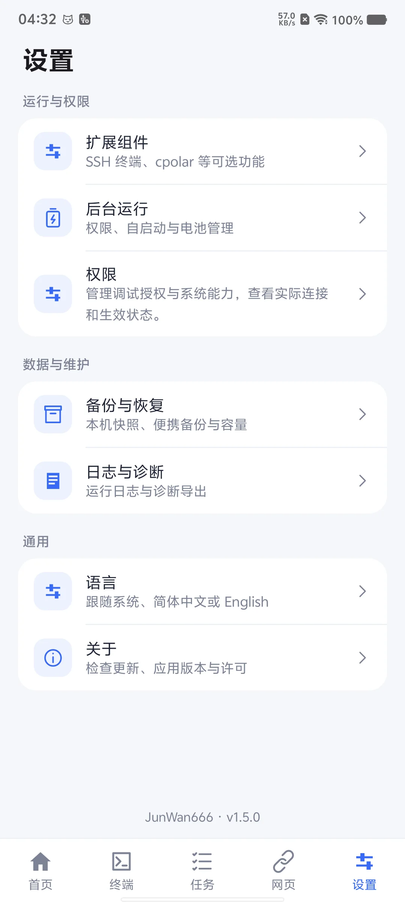
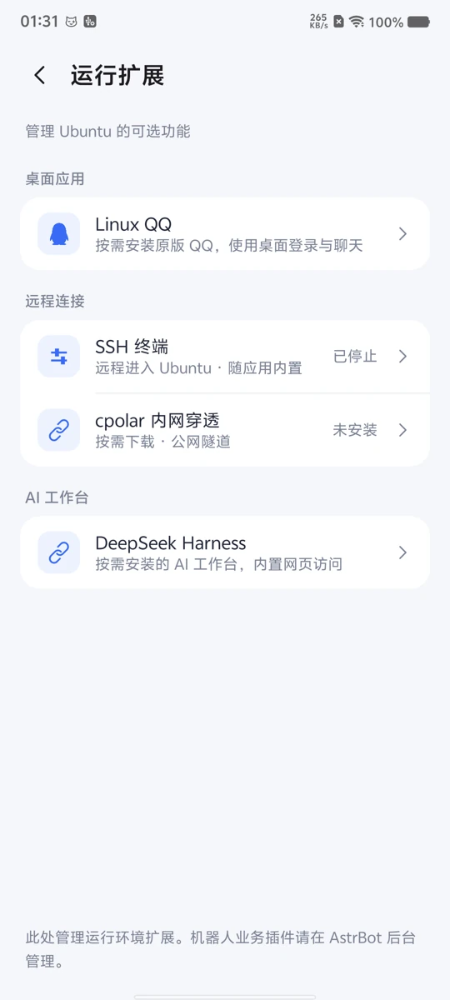
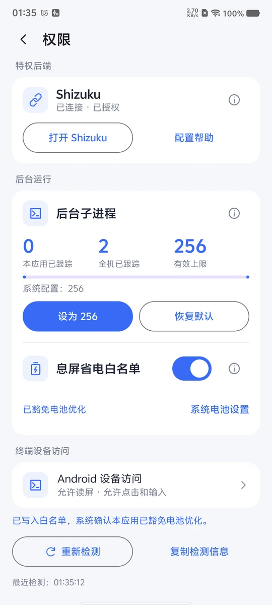
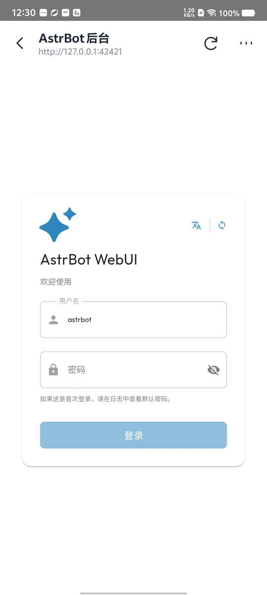
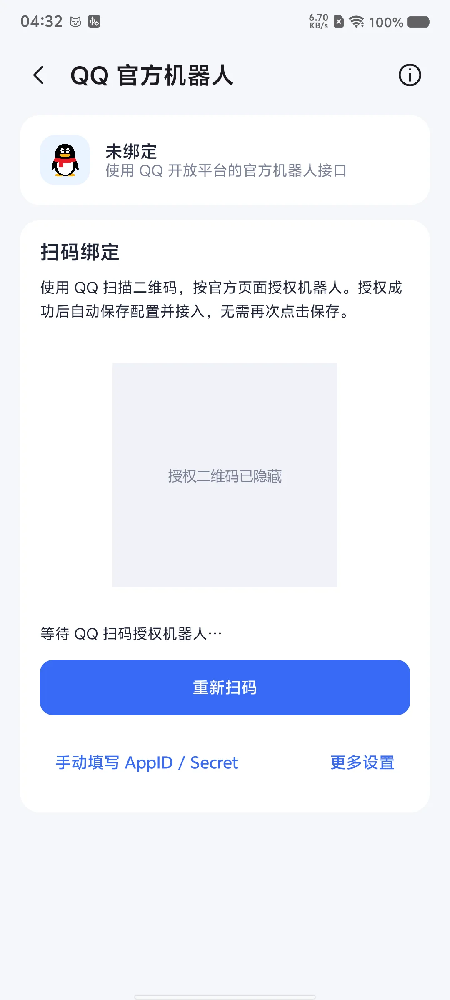
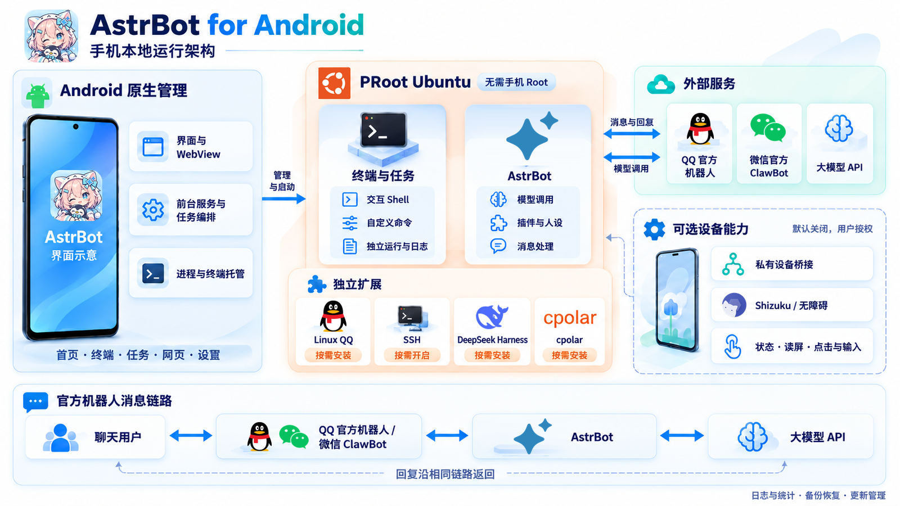

<div align="center">
  
  <h1>AstrBot for Android</h1>
  <p><strong>简体中文</strong> | <a href="./docs/README.en.md">English</a></p>
  <p><strong>在 Android 手机上运行 AstrBot，连接你的消息平台。</strong></p>
  <p>一个 APK · 本地运行 · 原生管理 · 内置 WebUI</p>
  <p>
    
    
    
  </p>
  <p>
    <a href="https://github.com/JunWan666/astrbot-for-android/releases/latest"></a>
    
    
    <a href="./LICENSE"></a>
    <a href="https://github.com/JunWan666"></a>
    <a href="https://github.com/JunWan666/astrbot-for-android/stargazers"></a>
    <a href="https://github.com/JunWan666/astrbot-for-android/releases"></a>
  </p>
  <p>
    <a href="https://github.com/JunWan666/astrbot-for-android/releases/latest">下载 APK</a> ·
    <a href="#界面预览">界面预览</a> ·
    <a href="#项目架构">项目架构</a> ·
    <a href="#开始使用">开始使用</a> ·
    <a href="./docs/使用指南.md">使用指南</a> ·
    <a href="./docs/构建指南.md">源码构建</a> ·
    <a href="./docs/CHANGELOG.md">更新记录</a>
  </p>
</div>

## 项目简介

**AstrBot for Android（AstrBot 运行管理器）** 是面向 Android 设备的 AstrBot 本地部署及运行管理应用。单个 APK 提供 PRoot Ubuntu、AstrBot 与通用运行依赖，支持环境初始化、服务启停、状态监控、日志查看、备份恢复及独立在线更新，无需 Root。

应用采用 Kotlin 与 Jetpack Compose 构建原生管理界面，支持简体中文与英文。从首页接入 QQ 官方机器人和微信官方 ClawBot，通过内置 WebView 配置 AstrBot 的模型、插件与人设；终端和任务页用于运行自行部署的 Ubuntu 程序，另提供局域网访问、SSH、Linux QQ 和 cpolar 等扩展。

当前最新正式版为 **1.5.0**：首页聚焦 AstrBot，新增 QQ 官方机器人与微信官方 ClawBot 配置入口、通用任务管理，Linux QQ 保留为独立桌面扩展，并完善环境兼容、更新、备份与诊断。升级影响及完整变更见[更新记录](docs/CHANGELOG.md)。

### 关于 NapCat 与 SnowLuma

早期版本曾提供 NapCat 内置接入和 SnowLuma 部署、运行入口。近期上游公开源码与下载渠道发生变化：截至 2026-11-18，[NapCat 原仓库](https://github.com/NapNeko/NapCatQQ)的默认分支仅保留 README，[SnowLuma 原仓库](https://github.com/SnowLuma/SnowLuma)已无法公开访问。为明确第三方授权与分发边界，并降低后续维护的不确定性，**从 1.5.0 起，本项目不再内置或提供这两个组件的专用安装、启停及部署教程**，重点维护 AstrBot、QQ 官方机器人、微信官方 ClawBot 和通用运行环境。

升级会停用旧版内置接入，保留 AstrBot 数据、账号资料及用户手动安装的软件；通用终端、任务和独立 Linux QQ 继续可用。Linux QQ 用于原版客户端登录与聊天，与机器人接入独立。旧 Release 描述的是对应历史版本，详见[旧版本升级](docs/使用指南.md#旧版本升级)。

## 界面预览

以下手机实机截图展示首页、任务、网页、分类设置、扩展、权限及内置后台。

首页、任务、网页、设置、扩展和 QQ 官方机器人配置展示 1.5.0 的界面布局，其余展示现有通用功能。

<table width="100%" align="center">
  <tr>
    <td align="center" width="25%">
      
      <p align="center"><strong>首页 · 服务与资源</strong></p>
    </td>
    <td align="center" width="25%">
      
      <p align="center"><strong>任务 · 独立运行与日志</strong></p>
    </td>
    <td align="center" width="25%">
      
      <p align="center"><strong>网页 · 快捷访问</strong></p>
    </td>
    <td align="center" width="25%">
      
      <p align="center"><strong>设置 · 分类管理</strong></p>
    </td>
  </tr>
  <tr>
    <td align="center" width="25%">
      
      <p align="center"><strong>扩展 · 按需安装</strong></p>
    </td>
    <td align="center" width="25%">
      
      <p align="center"><strong>权限 · 状态与统计</strong></p>
    </td>
    <td align="center" width="25%">
      
      <p align="center"><strong>AstrBot · 内置后台</strong></p>
    </td>
    <td align="center" width="25%">
      
      <p align="center"><strong>QQ · 官方机器人</strong></p>
    </td>
  </tr>
</table>

## 功能特性

| 功能 | 说明 |
| --- | --- |
| AstrBot 管理 | 首页启停、重启与后台入口，显示组件版本、真实就绪状态及 App 版本 |
| 内置后台 | 直接打开原 WebUI，预填有效的初始凭据，也可使用外部浏览器 |
| 固定缩放 | 默认 75%，支持 100% / 75% / 50% / 25%，关闭双指缩放 |
| 消息平台 | 从首页分别配置 QQ 官方机器人和微信官方 ClawBot，调用 AstrBot 接口保存凭据、扫码授权与启停连接，显示实际适配器状态 |
| 常用网页 | 保存常用网址，在内置浏览器访问，支持网站图标、编辑删除、缩放及外部应用跳转 |
| 局域网访问 | AstrBot 后台可按需开放局域网访问，显示可复制地址，保留后台鉴权 |
| 通用任务 | 自定义 Ubuntu 程序的运行目录与启动命令，支持独立启停、重启、运行时长、退出码及日志查看和清理 |
| 人设管理 | 从首页直达 AstrBot 人设页面，统一管理后台中的人设与提示词 |
| 实时日志 | 在服务详情中查看，自动跟随最新输出，可暂停、复制、脱敏导出、直接分享及手动清理；诊断包附带设备、系统与运行状态 |
| 资源概览 | 显示应用及托管进程内存、手机总内存和占比，单独查看存储使用情况 |
| 备份与恢复 | 本机快照、可选内容的 ZIP 导出、直接分享及跨手机导入，可选 QQ 会话；支持更新回退和自动快照清理 |
| SSH 扩展 | 默认安装、按需启动，支持修改密码、端口和局域网访问设置 |
| 终端 | 从底栏进入本机交互终端，支持多会话、平滑触摸滚动、方向键与粘贴回车；Android 9 及以上支持选字放大镜 |
| Linux QQ | 预置轻量桌面与通用工具，原版 ARM64 QQ 按需安装；打开时自动准备桌面，支持内嵌操作及可选的局域网访问 |
| cpolar 扩展 | 按需安装，内嵌官方 WebUI 登录与隧道管理，可选局域网访问，默认提供 SSH 和 AstrBot 隧道 |
| DeepSeek Harness | 按需准备独立 Node.js 与官方工作台，显示分阶段安装进度，可选局域网访问，自行配置模型 |
| 权限管理 | 提供官方 Shizuku 离线安装入口，检查后台子进程数量与有效上限，按需设置本应用的息屏省电白名单 |
| Android 设备访问 | 默认关闭，分别授权终端工具读屏、点击和输入；支持设备状态查询与共享目录文件交换 |
| 中英文界面 | 支持跟随系统、简体中文与 English，覆盖管理界面、通知与操作提示 |
| 后台引导 | 提供通知、电池优化、后台无限制、自启动权限及任务锁定入口，可选择在最近任务中隐藏 |
| 更新管理 | App 检查新版后可选择内置下载校验安装，或交给外部浏览器下载；AstrBot 独立更新及失败回退 |

设置、扩展和权限采用分类标题与分组卡片，连续排列，小屏或大字号下可滚动。底部导航为“首页、终端、任务、网页、设置”，QQ 和微信机器人从首页进入各自配置页。微信入口使用官方 ClawBot（openclaw-weixin / iLink）授权机器人，不托管微信客户端的账号登录态。QQ 下载显示大小、进度和速度，下载阶段可暂停、继续或停止。Linux QQ 的桌面随环境离线准备，局域网访问默认关闭，与手机共用同一个桌面会话。进入服务详情后，底部导航切换为该服务的概览、连接、凭据和日志，凭据页可重置忘记的后台密码或口令。

## 项目架构

原生 App 管理界面、前台任务和进程，AstrBot 在本机 PRoot Ubuntu 中运行。消息平台通过 AstrBot 调用用户配置的模型；终端、远程访问与其他接入方式独立管理。

<p align="center">
  <a href="./docs/images/architecture.webp"></a>
</p>

## 开始使用

1. 从 [Releases](https://github.com/JunWan666/astrbot-for-android/releases/latest) 下载完整 APK，在 ARM64 Android 手机上安装，打开 App 完成环境初始化。
2. 在首页启动 AstrBot，等待管理后台就绪。
3. 从首页选择 QQ 官方机器人或微信官方机器人，本机自动连接 AstrBot，无需重复输入后台密码。未绑定时直接显示二维码，用 QQ 或微信扫码授权，成功后自动保存并接入；已绑定时可重新绑定、启停或删除接入，首页同步显示绑定和运行状态。微信使用官方 ClawBot，模型和插件从首页快捷入口配置。
4. 按“设置 → 后台运行”的引导调整手机权限，再按需使用人设、备份、SSH 和 cpolar。“设置 → 权限”提供 Shizuku 的官方离线安装包及授权入口，Android 12 及以上可分别查看本应用、全机已跟踪的后台子进程数量及有效上限，并按需调整上限；安装后仍需启动和授权 Shizuku。系统未公开的数量不会显示为 0。

完整包内置运行环境，初始化无需另外下载 Ubuntu 或安装项目依赖。官方机器人授权、模型调用和在线更新需要网络；机器人在首页入口配置，模型 API Key 在 AstrBot 后台配置。更多操作见[使用指南](docs/使用指南.md)。

### 设备与空间

- Android 8.0 / API 26 及以上，ARM64 架构，无需手机 Root。
- 完整包包含 Ubuntu、AstrBot 和离线桌面资源；Linux QQ 从腾讯官网按需下载。安装后还需为运行环境、用户数据和备份预留空间，最终体积以新版本附件为准。
- 环境准备空间不足时显示预估提醒，可选择“仍然继续”；实际可写空间耗尽仍会导致操作失败。
- 运行占用随插件、模型调用及 QQ 状态变化；首页显示实际应用内存，不预分配虚拟机内存。
- 持续运行需要按手机系统设置后台权限。可选开启无障碍后台辅助及默认关闭的开机恢复服务，详见[后台运行](docs/使用指南.md#后台运行)。

cpolar 在“设置 → 扩展组件”中单独下载安装，客户端不打入 APK。登录官方 WebUI 后自动保存令牌，可管理 SSH 和 AstrBot 默认隧道；隧道目标服务需在 App 中启动，服务能力以 cpolar 账号套餐为准。

## 源码构建

使用 JDK 17、Android SDK 35、NDK 和 Python 3.11+。编译应用源码：

```powershell
./gradlew.bat :core:compileKotlin :app:compileBootstrapReleaseKotlin
```

完整 APK 需要另外准备运行镜像、原生资源和许可输入，大型资源与本机配置不进入 Git。准备好输入和长期签名后，Windows 双击根目录 `build.bat`，其他系统执行 `python3 -B tools/build_release.py`，即可完成正式构建、签名和校验。默认输出到 `dist/`，具体步骤见[构建指南](docs/构建指南.md)。

长期密钥及密码位于 Git 已忽略的 `.local/signing/`，后续版本持续复用；首次创建与备份方法见[一键构建正式包](docs/构建指南.md#一键构建正式包)。

## 更新

“设置 → 关于 → 检查更新”管理 App 安装包：发现新版后弹窗显示说明，可选择“下载并安装”或使用外部浏览器下载。内置下载完成后自动校验，再进入系统安装器；缺少安装权限时引导授权，返回后继续。当前已是适用的最新版本时会明确提示。AstrBot 保留独立程序更新。内置流程保留签名校验、断点续传、安装前快照和组件失败回退，APK 安装由系统确认。

管理器 APK 使用本项目 GitHub 签名通道。AstrBot 默认直接检查其**官方 GitHub 最新稳定 Release**，查看说明后点击“下载并更新”，连续完成下载、检查、备份和安装；定制构建仍支持原有签名目录。AstrBot 同时更新源码与匹配 WebUI，现有 Python 依赖或数据迁移实现不满足时会在替换前停止；上游新版不保证兼容现有依赖或插件，服务检查失败时恢复原程序和数据。配置方式见[更新与分发](docs/更新与分发.md)。

## 交流与反馈

<p align="center">
  <a href="https://qm.qq.com/q/fS2CdoBQB2"></a>
</p>

欢迎加入 QQ 交流群，交流 App 使用、AstrBot 配置、人设分享和功能建议。也可以通过 [GitHub Issues](https://github.com/JunWan666/astrbot-for-android/issues) 反馈问题，便于跟进和检索。

## 文档

- [使用指南](docs/使用指南.md)：机器人接入、终端、任务、人设、网页、权限、扩展、备份和旧版迁移。
- [构建指南](docs/构建指南.md)：开发环境、运行资源和 APK 构建。
- [更新与分发](docs/更新与分发.md)：应用签名、更新通道和 GitHub 发布。
- [发行材料](docs/发行材料.md)：第三方许可、依赖清单和源码伴随包。
- [更新记录](docs/CHANGELOG.md) · [参与开发](.github/CONTRIBUTING.md) · [提交规则](.github/GIT_COMMIT_RULES.md)。

## 开源协议与致谢

本项目原创代码采用 [MIT License](LICENSE)，**Copyright © 2026 [JunWan666](https://github.com/JunWan666)**。使用或分发时请保留版权声明和许可文本。

感谢 [AstrBot](https://github.com/AstrBotDevs/AstrBot)、[PRoot](https://github.com/proot-me/proot)、Ubuntu、Termux 及相关开源项目。第三方组件遵循各自的许可与分发条款，详见 [NOTICE](docs/legal/NOTICE) 和 [第三方声明](docs/legal/THIRD_PARTY_NOTICES.md)。

## Star History

<div align="center">
  <a href="https://www.star-history.com/?repos=JunWan666%2Fastrbot-for-android&amp;type=date&amp;legend=top-left">
    <picture>
      <source media="(prefers-color-scheme: dark)" srcset="https://api.star-history.com/chart?repos=JunWan666/astrbot-for-android&amp;type=date&amp;theme=dark&amp;legend=top-left" />
      <source media="(prefers-color-scheme: light)" srcset="https://api.star-history.com/chart?repos=JunWan666/astrbot-for-android&amp;type=date&amp;legend=top-left" />
      
    </picture>
  </a>
</div>
