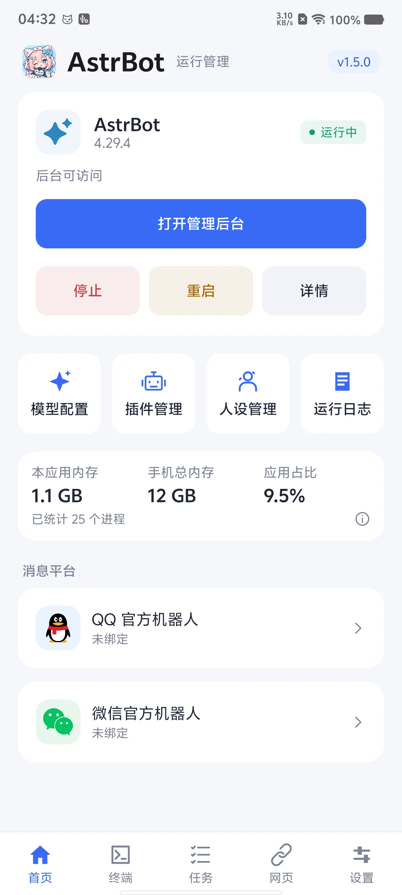
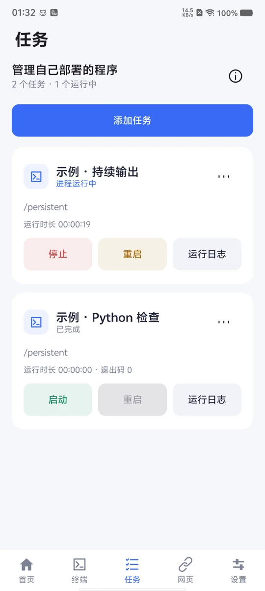
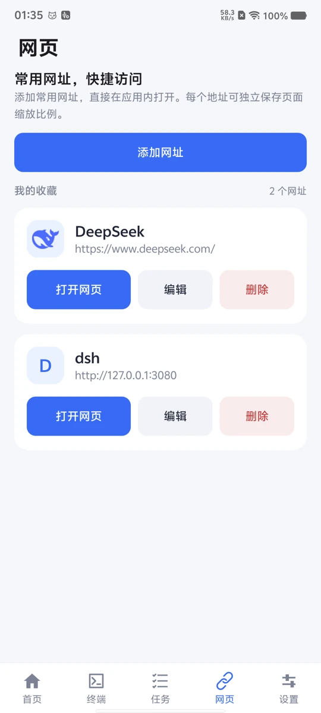
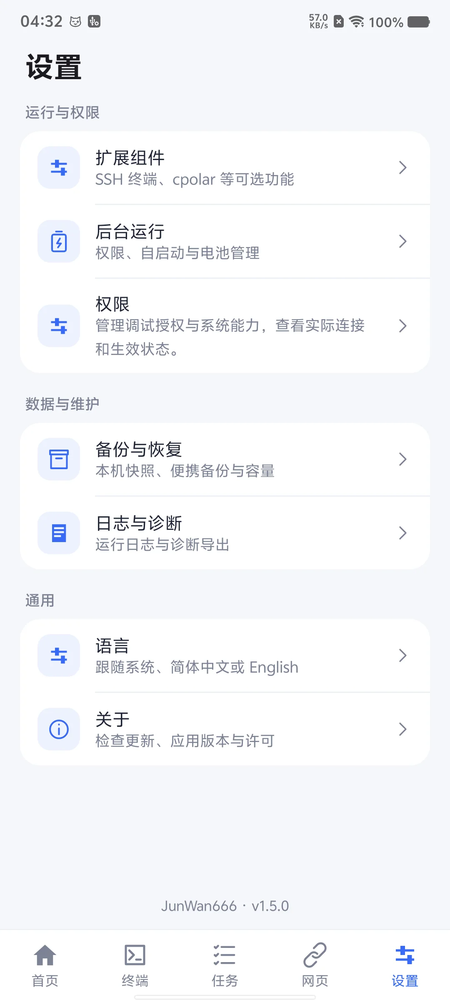
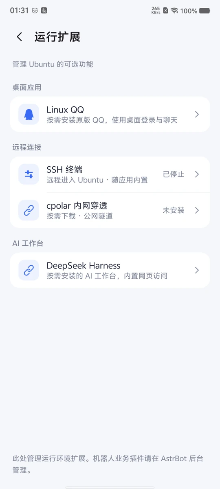
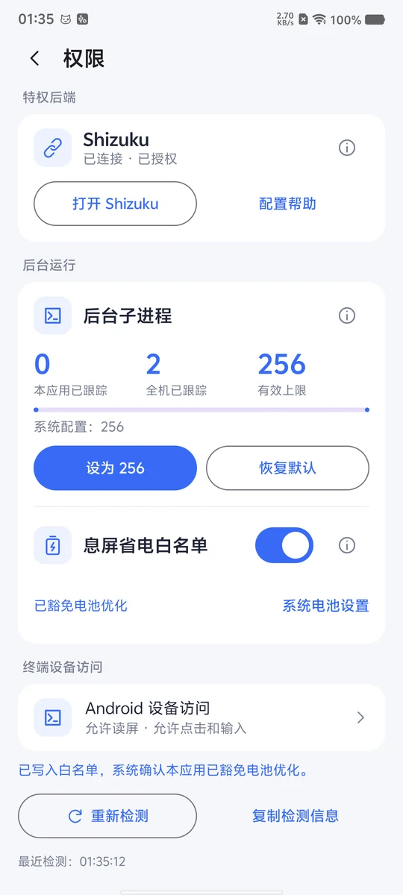
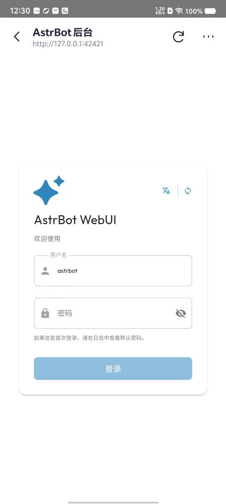
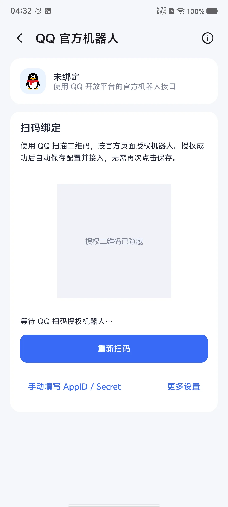
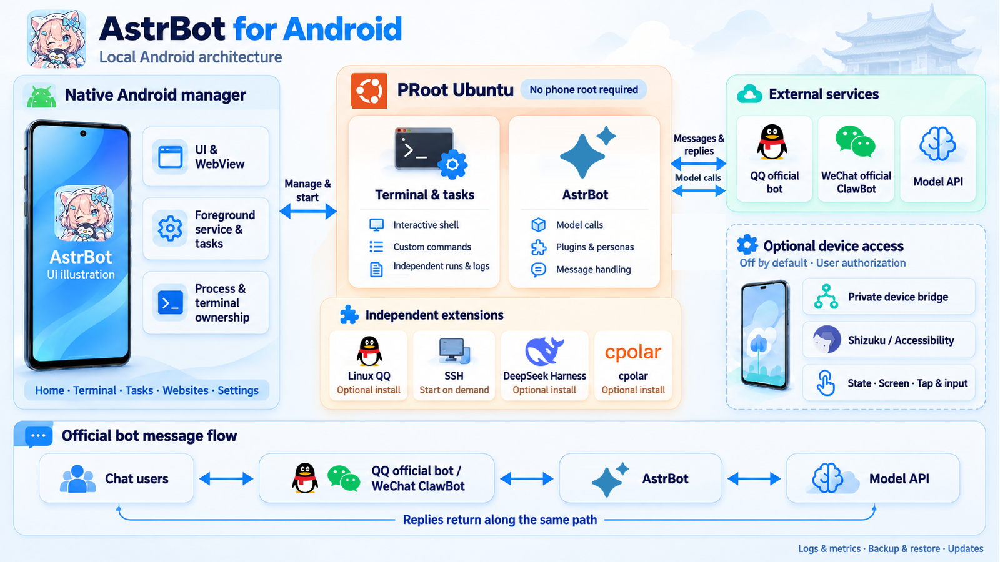

<div align="center">
  
  <h1>AstrBot for Android</h1>
  <p><a href="../README.md">简体中文</a> | <strong>English</strong></p>
  <p><strong>Run AstrBot on your Android device.</strong></p>
  <p>One APK · Local execution · Native management · Built-in WebUIs</p>
  <p>
    
    
    
  </p>
  <p>
    <a href="https://github.com/JunWan666/astrbot-for-android/releases/latest"></a>
    
    
    <a href="../LICENSE"></a>
    <a href="https://github.com/JunWan666"></a>
    <a href="https://github.com/JunWan666/astrbot-for-android/stargazers"></a>
    <a href="https://github.com/JunWan666/astrbot-for-android/releases"></a>
  </p>
  <p>
    <a href="https://github.com/JunWan666/astrbot-for-android/releases/latest">Download APK</a> ·
    <a href="#screenshots">Screenshots</a> ·
    <a href="#architecture">Architecture</a> ·
    <a href="#getting-started">Getting started</a> ·
    <a href="./使用指南.md">User guide (Chinese)</a> ·
    <a href="#building-from-source">Build from source</a> ·
    <a href="./CHANGELOG.md">Changelog (Chinese)</a>
  </p>
</div>

## Overview

**AstrBot for Android** (AstrBot 运行管理器) deploys and manages AstrBot locally on Android. A single APK includes PRoot Ubuntu, AstrBot and shared runtime dependencies, with environment setup, service controls, status monitoring, logs, backup and restore, and independent updates. Root access is not required.

Built with Kotlin and Jetpack Compose, the app provides native management in Simplified Chinese and English. Connect QQ official bots and official WeChat ClawBot from Home, and use the embedded AstrBot WebUI for models, plugins and personas. Terminal and Tasks run user-deployed Ubuntu programs; optional extensions include LAN access, SSH, Linux QQ and cpolar.

Latest stable release: **1.5.0**, with an AstrBot-focused home, native QQ official bot and official WeChat ClawBot configuration, general task management, standalone Linux QQ, and runtime, update, backup and diagnostics improvements. See the [changelog (Chinese)](CHANGELOG.md) for upgrade notes and the full list of changes.

### About NapCat and SnowLuma

Earlier versions included NapCat integration and SnowLuma deployment and runtime controls. Upstream source and download availability have since changed: as of 2026-11-18, the default branch of the [original NapCat repository](https://github.com/NapNeko/NapCatQQ) contains only a README, and the [original SnowLuma repository](https://github.com/SnowLuma/SnowLuma) is no longer publicly accessible. To keep third-party licensing and distribution boundaries clear and reduce maintenance uncertainty, **starting with 1.5.0, this project no longer bundles either component or provides dedicated installation, runtime controls or deployment tutorials**. Development focuses on AstrBot, QQ official bots, official WeChat ClawBot and the shared runtime.

Upgrading disables the old bundled integrations while retaining AstrBot data, account files and user-installed software. Terminal, Tasks and standalone Linux QQ remain available. Linux QQ provides the original desktop client for login and chat, independently of bot integration. Older releases describe their historical behavior; see [upgrading from older versions (Chinese)](使用指南.md#旧版本升级).

## Screenshots

The eight screenshots were captured on an Android phone and show service management, tasks, websites, grouped settings, extensions, permissions and the embedded AstrBot dashboard and official bot authorization.

Home, Tasks, Websites, Settings, Extensions and QQ official bot configuration show the 1.5.0 layout; the other screenshots illustrate existing shared features.

<table width="100%" align="center">
  <tr>
    <td align="center" width="25%">
      
      <p align="center"><strong>Home · Services &amp; resources</strong></p>
    </td>
    <td align="center" width="25%">
      
      <p align="center"><strong>Tasks · Run &amp; inspect</strong></p>
    </td>
    <td align="center" width="25%">
      
      <p align="center"><strong>Websites · Quick access</strong></p>
    </td>
    <td align="center" width="25%">
      
      <p align="center"><strong>Settings · Grouped menus</strong></p>
    </td>
  </tr>
  <tr>
    <td align="center" width="25%">
      
      <p align="center"><strong>Extensions · On demand</strong></p>
    </td>
    <td align="center" width="25%">
      
      <p align="center"><strong>Permissions · Live status</strong></p>
    </td>
    <td align="center" width="25%">
      
      <p align="center"><strong>AstrBot · Built-in WebUI</strong></p>
    </td>
    <td align="center" width="25%">
      
      <p align="center"><strong>QQ · Official bot</strong></p>
    </td>
  </tr>
</table>

The screenshots show the app in Simplified Chinese. English is also available in Settings → Language.

## Features

| Feature | Description |
| --- | --- |
| AstrBot management | Start, stop and restart AstrBot from Home; view the actual app version, core version and readiness. |
| Built-in WebUIs | Open the original WebUIs with valid initial credentials prefilled, or use an external browser. |
| Fixed zoom | Defaults to 75%, with 100% / 75% / 50% / 25% options; pinch zoom is disabled. |
| Messaging platforms | Separate native pages from Home for QQ official bot credentials and official WeChat ClawBot authorization, saved through AstrBot APIs, with enable/disable controls and expiring adapter status. |
| Websites | Bookmark sites in the embedded browser, with site icons, editing, zoom and external app links. |
| LAN access | Optionally allow LAN access to AstrBot, copy its address, and retain WebUI authentication. |
| Custom tasks | Set a working directory and command for Ubuntu programs; start, stop, restart, inspect run time and exit codes, and view or clear bounded logs |
| Persona management | Open AstrBot’s own persona page directly from Home to manage personas and prompts |
| Live logs | Follow service output, pause, copy, export or directly share redacted logs, and clear retained history. Diagnostic archives include device, system and runtime status. |
| Resource overview | View memory usage for the app and managed processes, total device memory and the usage percentage. Storage usage is shown separately. |
| Backup and restore | Local snapshots, selective ZIP exports, direct sharing and imports across phones, optional QQ sessions, update rollback and automatic snapshot cleanup. |
| SSH extension | Installed by default and started on demand, with configurable password, port and LAN access. |
| Terminal | Local shell from the bottom navigation, with multiple sessions, smooth touch scrolling, arrow keys, paste and Enter. Text selection magnifier on Android 9 and later. |
| Linux QQ | Bundled lightweight desktop and general tools, with optional original ARM64 QQ installation. Opening QQ prepares the desktop automatically; use the embedded viewer or opt-in LAN access to the same session. |
| cpolar extension | Install on demand, manage tunnels in the official WebUI and optionally allow LAN access. Includes SSH and AstrBot tunnel presets. |
| DeepSeek Harness | Optional independent Node.js runtime and official AI workspace, with staged installation progress and optional LAN access. |
| Permission management | Install the official Shizuku APK offline, inspect tracked child processes and their effective limit, and optionally exempt this app from Android idle restrictions. |
| Android device access | Disabled by default; separately allow screen reading and input for local terminal tools, with device state queries and shared file exchange. |
| App language | Choose system default, Simplified Chinese or English for the management interface, notifications and app messages. |
| Background setup | Access notification, battery optimization, unrestricted background usage and auto-start settings, with guidance for locking the app in recent tasks and an option to hide its task cards. |
| Updates | Review release notes and choose in-app download with verification and installation, or download in an external browser. AstrBot has independent updates and rollback. |

Settings, extensions and permissions use section headings and grouped cards in a continuous menu, with scrolling on small screens or at larger font sizes. Opening a service switches the bottom navigation to that service's overview, connections, credentials and logs. Its credentials page can reset a forgotten WebUI password or access token.

The Websites tab and saved bookmarks are retained; QQ and WeChat bots are configured from Home. WeChat uses the official ClawBot (openclaw-weixin / iLink) bot authorization API without hosting a WeChat client login session. The shared WebView supports zoom, login redirects and external app links. Original QQ downloads show bytes, total size and speed, with pause, resume and stop during download. Desktop dependencies are prepared offline, and optional LAN access shares the phone desktop session.

## Architecture

The native app manages the interface, foreground tasks and local processes. AstrBot runs in PRoot Ubuntu and connects messaging adapters to the configured model provider. Terminal, remote access and other connection methods remain independent.

<p align="center">
  <a href="./images/architecture.en.webp"></a>
</p>

## Getting started

1. Download the full APK from [Releases](https://github.com/JunWan666/astrbot-for-android/releases/latest), install it on an ARM64 Android device, then open the app and initialize the environment.
2. Start **AstrBot** on Home and wait for its dashboard to become ready.
3. Choose **QQ Official Bot** or **WeChat Official Bot** on Home. The app connects to local AstrBot without another dashboard password. An unbound platform displays its QR code immediately. Scan with QQ or WeChat; successful authorization is saved and connected automatically. Existing connections support rebinding, enable/disable and removal; Home shows binding and adapter status. WeChat uses official ClawBot authorization. Use Home shortcuts for models and plugins.
4. Follow **Settings → Background running** to adjust device permissions, then configure personas, backups, SSH and cpolar as needed. **Settings → Permissions** provides an official offline Shizuku installer. On Android 12 and later, it separately displays tracked child process counts for this app and the device, plus the effective limit, which you can adjust if needed. Unavailable counts are never reported as zero. Start and authorize Shizuku after installation.

The full APK includes the runtime environment, so initialization does not require a separate Ubuntu download or dependency installation. Official bot authorization, model API calls and online updates require network access. Configure bots from Home and model API keys in AstrBot's dashboard. See the [user guide (Chinese)](使用指南.md) for more details.

### Device and storage requirements

- Android 8.0 / API 26 or later, with an ARM64 processor. Root access is not required.
- The full APK includes Ubuntu, AstrBot and offline desktop resources. Linux QQ is downloaded directly from Tencent on request. Allow additional storage for the extracted environment, user data and backups; see the new release attachment for the final APK size.
- If free space is below the runtime preparation estimate, a warning offers **Continue anyway**. Running out of writable storage can still cause the operation to fail.
- Resource usage varies with plugins, model calls and QQ activity. Home displays actual app memory usage; the app does not preallocate memory for a virtual machine.
- Continuous operation requires appropriate background permissions on the device. Accessibility assistance and service recovery after reboot are optional and disabled by default; see the [background operation guide (Chinese)](使用指南.md#后台运行).

Install cpolar separately in **Settings → Runtime extensions**; its client is not bundled in the APK. Sign in through its official WebUI to save the token automatically and manage the SSH and AstrBot tunnel presets. Start each target service in the app before using its tunnel. Features depend on your cpolar account plan.

## Building from source

Use JDK 17, Android SDK 35, the Android NDK and Python 3.11+. Compile the application sources with:

```powershell
./gradlew.bat :core:compileKotlin :app:compileBootstrapReleaseKotlin
```

A full APK additionally requires a prepared runtime image, native resources and license inputs. Large assets and machine settings are excluded from Git. Once these inputs and the long-term signing configuration are ready, double-click `build.bat` on Windows, or run `python3 -B tools/build_release.py` on other systems. The script displays Chinese progress messages, builds and verifies a signed release, and exports it to `dist/` by default. See the [build guide (Chinese)](构建指南.md).

The keystore and credentials stay in the Git-ignored `.local/signing/` directory and are reused for later releases. See [signing initialization and backup (Chinese)](构建指南.md#一键构建正式包).

## Updates

**Settings → About → Check for updates** manages app APK updates. A dialog shows release notes and offers an in-app download or an external browser. The in-app download verifies the APK and opens the system installer; if installation permission is missing, the app guides you to settings and continues when you return. A message confirms when the latest applicable version is installed. AstrBot retains its component update entry. The in-app flow retains signature verification, resumable downloads, snapshots before installation and component rollback. Android asks you to confirm APK installation.

App APK updates use this project's signed GitHub channel. AstrBot checks its **official GitHub stable releases** directly by default. Review the notes and choose **Download and update** to download, verify, back up and install; custom builds can still use signed catalogs. AstrBot updates include matching source and dashboard files. Missing Python dependencies or unsupported migration implementations stop the update before replacement. New upstream versions may be incompatible with existing adapters, dependencies or plugins; failed service checks restore the previous program and data. See [updates and distribution (Chinese)](更新与分发.md) for details.

## Community

<p align="center">
  <a href="https://qm.qq.com/q/fS2CdoBQB2"></a>
</p>

Join the QQ community to discuss app usage, AstrBot configuration, personas and feature ideas. Group discussions are primarily in Chinese. You can also report issues through [GitHub Issues](https://github.com/JunWan666/astrbot-for-android/issues) for tracking and reference.

## Documentation

The detailed guides and project policies below are currently available in Chinese.

- [User guide](使用指南.md): WebUI configuration, personas, messaging platforms, permissions, device access, extensions, resources and backups.
- [Build guide](构建指南.md): Development tools, runtime assets and APK builds.
- [Updates and distribution](更新与分发.md): App signing, update channels and GitHub publishing.
- [Distribution materials](发行材料.md): Third-party licenses, dependency inventories and accompanying source archives.
- [Changelog](CHANGELOG.md) · [Contributing](../.github/CONTRIBUTING.md) · [Commit rules](../.github/GIT_COMMIT_RULES.md).

## License and acknowledgements

Original code in this project is licensed under the [MIT License](../LICENSE). **Copyright © 2026 [JunWan666](https://github.com/JunWan666)**. Retain the copyright notice and license text when using or distributing the code.

Thanks to [AstrBot](https://github.com/AstrBotDevs/AstrBot), [PRoot](https://github.com/proot-me/proot), Ubuntu, Termux and the related open-source projects. Third-party components remain subject to their respective licenses and distribution terms. See [NOTICE](legal/NOTICE) and [third-party notices](legal/THIRD_PARTY_NOTICES.md).

## Star History

<div align="center">
  <a href="https://www.star-history.com/?repos=JunWan666%2Fastrbot-for-android&amp;type=date&amp;legend=top-left">
    <picture>
      <source media="(prefers-color-scheme: dark)" srcset="https://api.star-history.com/chart?repos=JunWan666/astrbot-for-android&amp;type=date&amp;theme=dark&amp;legend=top-left" />
      <source media="(prefers-color-scheme: light)" srcset="https://api.star-history.com/chart?repos=JunWan666/astrbot-for-android&amp;type=date&amp;legend=top-left" />
      
    </picture>
  </a>
</div>
